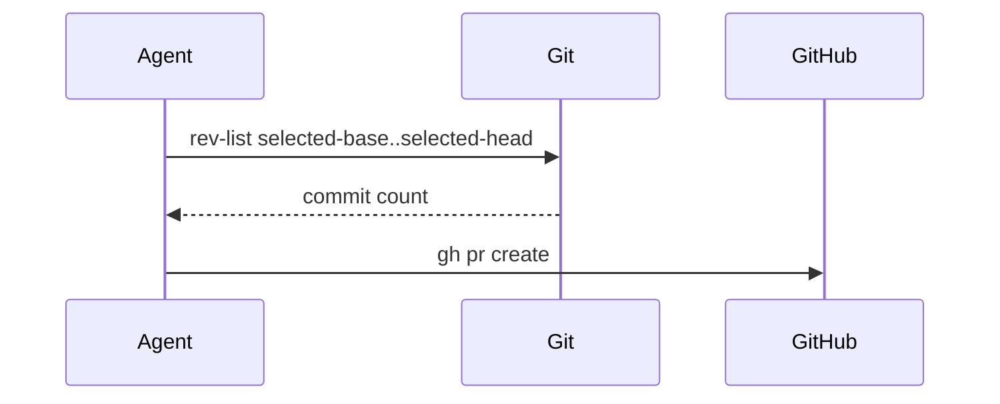

# Create PR workflow

1. Resolve the selected head and base once. An explicit `--head` is the
   selected head. When `--head` is omitted, the selected head is the current
   branch from `git rev-parse --abbrev-ref HEAD`. An explicit `--base` is the
   selected base. An explicit `--base` wins. When `--base` is omitted and the
   consumer project's instructions supply `{TARGET_BRANCH}`, use that value.
   dhpk does not define a userConfig key for `{TARGET_BRANCH}` or
   `{TICKET_PATTERN}`. When `{TARGET_BRANCH}` is unset, the generic fallback is `main`.
   The consumer project's Project Convention supplies any project-specific
   base; use the explicit option or project instructions to select it. Confirm
   both refs with `git rev-parse --verify`. A missing
   repository, or a head or base that does not resolve, is a terminal
   `BLOCKED` result. Do not substitute the checkout branch, `HEAD`, or
   another ref, and do not commit, check out, or push.
2. Record the checkout branch separately from the selected head. Gather
   recent commits and the pull-request diff for the selected range only:

   ```bash
   git log --oneline <selected-base>..<selected-head>
   git diff --stat <selected-base>...<selected-head>
   ```

   The two-dot log is the commit list. The three-dot diff is the change from
   the merge base, which is the pull-request comparison. Keep those formulas
   distinct, and do not replace either one with checkout `HEAD`.
3. Extract the first ticket matching `{TICKET_PATTERN}` from the selected
   head name. When the project does not set `{TICKET_PATTERN}`, use `[A-Z]+-\d+`. Use the repository's ticket URL
   convention when building the ticket link. If no ticket can be resolved,
   state that in the report and do not invent one.
4. Derive the title as `<type>: [<TICKET>] <summary>` unless `--title` is
   supplied. Build the body with the [PR body](#pr-body) sections, in that
   order, including the ticket link when a ticket is resolved and a
   verification section. List commands and results only for checks observed
   on the selected range. A result observed only on a different checkout is
   `NOT RUN` for this request, and the reason names that checkout. Put
   planned or unavailable checks under `NOT RUN` with the reason. Keep
   shell quoting intact in the emitted command.
5. Count commits on the selected range:

   ```bash
   git rev-list --count <selected-base>..<selected-head>
   ```

   If the result is `0`, stop before any `gh pr create` call and report
   `No commits between <selected-base> and <selected-head> — nothing to open a PR for`.
   The message names the refs actually selected. A zero count on the checkout
   does not reject a selected head that has commits. A non-zero count on the
   checkout does not allow a selected head whose selected range is empty.
6. Verify the selected head has a remote ref. The workflow does not push it.
   Query existing PRs for that same head and base. An unpushed selected head
   or an existing matching PR is a terminal `BLOCKED` result.
7. Construct the `gh pr create` command with `--head <selected-head>`,
   `--base <selected-base>`, `--title`, and `--body`. `--dry-run` and omitted
   mode print the command only. Do not call `gh pr create` in that mode.
8. For `--execute`, show the final command, ask for confirmation, and call it
   only after confirmation. Use the caller's existing `gh` credentials and
   report the returned URL. A rejected confirmation, auth error, or command
   failure is `FAIL`, not a created PR.

## Command contract

The command contract is `[--head <branch>] [--base <branch>] [--title <text>]
[--execute] [--dry-run]`; no other mode or push option is inferred.

## PR body

Section names and Door / Blast Radius grading are adapted from the
engineering [`pr` skill](https://github.com/mattpocock/skills/blob/main/skills/engineering/pr/SKILL.md),
which credits Dex Horthy's [`show-me`](https://github.com/humanlayer/skills/blob/main/plugins/show-me/skills/show-me/SKILL.md).
The allowed Summary forms are the five in the table below. The examples are
dhpk's and use standalone snippets.

Use this shape:

```markdown
## Summary

<one visual form>

## Evidence

- **Before:** <pre-change failure, log, or screenshot, with where it was observed>
- **After:** <verification result on the selected head, or `expected`>

## Merge Danger

**Door:** one-way | two-way

<why a revert restores the previous behavior, or which effect a revert leaves in place>

**Blast Radius:** <callers, packages, or consumer surfaces>

<chain reaction, when one exists>

## Ticket

<ticket link when a ticket is resolved; omit this section otherwise>

## Verification

<commands and results observed on the selected range>

### NOT RUN

<planned or unavailable checks, each with a reason>
```

### Summary

Use one form. Pick the smallest form that shows the change.

| The change is about | Use |
| --- | --- |
| A branch or decision | Pseudocode |
| Who calls whom | A call tree |
| UI composition | A component tree |
| Messages between parts | A Mermaid sequence diagram |
| A small edit inside a shape that already exists | A minimal diff |

Pseudocode:

```text
resolveBase(explicit, projectTarget)
  when explicit is set
    return explicit
  when projectTarget is set
    return projectTarget
  return "main"
```

Call tree:

```text
createPullRequest
  resolveRange
    verifyRefs
    countCommits
  renderBody
  publish
```

Component tree:

```text
<CheckoutPage> (app/checkout/page.tsx)
  useCart()
  <PaymentFields>
    <SubmitOrder>
```

Mermaid sequence:



Minimal diff:

```diff
 resolveBase()
-  return "main"
+  when projectTarget is set
+    return projectTarget
+  return "main"
```

### Evidence

Before is the pre-change failure, log, or screenshot. Name where it was
observed: the selected base, the ticket, or a captured run. When that
observation is missing, say it was not observed.
After is the verification result observed on the selected head. When that
after-state was not observed, write `expected` and list its check under
`NOT RUN`.

### Merge Danger

Door is `two-way` when a revert restores the previous behavior. Door is
`one-way` when the merge deletes data, publishes an artifact, rotates a
secret, or leaves another effect that a revert does not undo.

Blast Radius names the callers, packages, or consumer surfaces the selected
diff touches, and the chain reaction when one exists.
